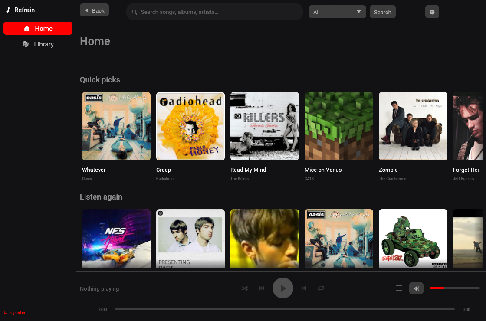

<p align="center">
  
</p>

<h1 align="center">Refrain</h1>

<p align="center"><b>YouTube Music, native and fast.</b><br>
A lightweight desktop client for YouTube Music, written in Rust.</p>

<p align="center">
  <a href="LICENSE"></a>
  
  
</p>



Refrain plays your YouTube Music library without a browser engine. It talks to
the same internal endpoints the web app uses, and streams audio through
`yt-dlp`. No web view and no Electron: the window is up in about half a second
(0.49 s measured), and the release build holds a steady ~215 MB resident with
the home feed loaded — it does not creep as you browse.

Sign in by reusing the session your browser already has — no separate login, no
password to hand over.

| | |
| --- | --- |
| **Search** | Songs, videos, albums, artists and playlists, grouped into categories with "See more" to expand one. |
| **Browse** | Home and Library feeds, album / artist / playlist pages, cover-art grids, carousels and "quick picks". |
| **Playback** | Streams through `yt-dlp` and caches to disk, so replays are instant. Seek, volume, shuffle, repeat, auto-advance. |
| **Your library** | Thumbs up and down, playlists you can add to, and an "Up next" queue. |
| **Desktop integration** | Media keys, the panel's media widget and `playerctl`, through MPRIS. |
| **Themes** | Light and dark, persisted in the config. Roboto is bundled, so it looks the same on every desktop. |
| **Keyboard** | Space, arrows, `Shift`+arrows, `/` and `Esc` — see [shortcuts](#keyboard-shortcuts). |

## Install

### Release bundle (Linux x86_64)

Download the tarball from [Releases](../../releases), then install it for your
user:

```sh
tar xzf refrain-*-linux-x86_64.tar.gz
cd refrain-*-linux-x86_64

install -Dm755 refrain ~/.local/bin/refrain
install -Dm644 refrain.svg ~/.local/share/icons/hicolor/scalable/apps/refrain.svg
install -Dm644 refrain.desktop ~/.local/share/applications/refrain.desktop
install -Dm644 refrain.metainfo.xml ~/.local/share/metainfo/refrain.metainfo.xml

# yt-dlp ships beside the binary, which is where Refrain looks for it first:
cp yt-dlp_linux ~/.local/bin/yt-dlp_linux
```

The bundle contains `yt-dlp` so you don't have to install it yourself. `ffmpeg`
is still needed, but only for the fallback that transcodes a stream the fast path
couldn't use.

### From source

```sh
git clone https://github.com/OWNER/refrain
cd refrain
cargo run --release
```

## Requirements

**To run it:**

- **`yt-dlp`** — found on `PATH`, at `~/.local/bin/yt-dlp`, or set `YTDLP_PATH`.
  The release bundle ships one.
- **A JavaScript runtime** — `node` or `deno` on `PATH`. `yt-dlp` needs one to
  solve YouTube's JS challenges, and Refrain passes `--js-runtimes` for you.
- **`ffmpeg`** — only for the download fallback.
- **A signed-in browser** for your library and reliable playback. Anonymous
  playback is bot-blocked for much of the catalogue.

**To build it:**

- Rust (stable)
- `alsa-lib-devel` (ALSA, for `rodio`)
- X11 and Wayland development libraries (for `eframe`/`winit`)
- For Chromium-family browsers on Linux, Python **`secretstorage`** may be needed
  to decrypt cookies from the OS keyring

No D-Bus development headers are needed: the media controls use `zbus`, which is
pure Rust.

## First run

Refrain looks for a signed-in browser session on startup — Firefox, and the
Chromium family including Flatpak installs — and reuses whichever one actually
has a **YouTube** session. A Google login alone isn't enough; InnerTube needs a
real YouTube session.

If your library looks empty, check what it found:

```sh
cargo run -- --auth-check
```

It lists the browsers it detected, whether cookies resolve, and whether
InnerTube recognises you as logged in. If it reports `anonymous ❌`, open
<https://music.youtube.com> in that browser, sign in, confirm you can see your
account, and re-run. To force a fresh extraction:

```sh
cargo run -- --auth-check --refresh
```

## Keyboard shortcuts

| Key | Action |
| --- | --- |
| `Space` | Play / pause |
| `→` / `←` | Seek forward / back 5 s |
| `Shift`+`→` / `Shift`+`←` | Next / previous track |
| `/` | Focus search |
| `Esc` | Back |

## Status

Working today:

- Filtered search, grouped results, and "See more" per category
- Home and Library feeds, with shelves paged in via continuations
- Album, artist and playlist pages, with artwork and carousels
- Streaming playback with on-disk write-through, prefetching and a download fallback
- Thumbs up / down, playlists you can add to, shuffle, repeat, "Up next" queue
- MPRIS media controls, media keys and `playerctl`
- Light and dark themes, with Roboto bundled rather than assumed
- Feed shelves as sideways-scrolling carousels, as YouTube Music shows them
- A release bundle with `yt-dlp` shipped beside the binary

Not built yet:

- Renaming, deleting and removing tracks from playlists. The API is in place,
  but the app can't yet tell which playlists you own, and offering "Delete
  playlist" on a guess isn't worth it.
- An in-app settings panel — edit `config.toml` for now
- Packaging beyond the tarball (no Flatpak, AUR or `.deb` yet)

Known limitations:

- **Anonymous playback is unreliable.** YouTube bot-blocks much of the catalogue
  without a signed-in session.
- **The first play of a track takes a few seconds** while `yt-dlp` resolves the
  stream URL. Prefetching hides this for tracks you hover or that a page warms;
  repeats are instant.
- **`yt-dlp` is a hard dependency.** Getting the stream URL means solving
  YouTube's JS challenges, which is the part `yt-dlp` exists to maintain —
  [why that isn't reimplemented](docs/architecture.md#why-the-cipher-isnt-reimplemented).
- The InnerTube endpoints are unofficial and may need updating over time.

## Development

```sh
cargo run --release          # run it
cargo fmt --all --check      # formatting
cargo clippy --all-targets -- -D warnings
cargo test
```

Useful diagnostics, all of which run without a GUI:

```sh
cargo run -- --auth-check             # sign-in diagnostics
cargo run -- --probe "daft punk"      # exercise search + browse
cargo run -- --page FEmusic_home      # dump a page's tracks and shelves
cargo run -- --stream <video_id>      # stream + report time-to-first-audio
cargo run -- --download <video_id>    # resolve, cache, and decode one track
cargo run -- --decode <path>          # decode a local audio file
cargo run -- --thumb <url>            # verify the artwork pipeline
cargo run -- --like-status <video_id> # read a track's rating (read-only)
```

Design notes, and the parts that turned out to be less obvious than they looked,
are in **[docs/architecture.md](docs/architecture.md)**.

Contributions are welcome — issues and pull requests both. If you're changing
how responses are parsed, note that YouTube reshuffles its JSON regularly and the
parser is deliberately tolerant rather than strict.

## Legal

Refrain is an independent project and is not affiliated with, endorsed by, or
sponsored by YouTube or Google. "YouTube" is a trademark of Google LLC.

It is intended for personal, educational use. Respect YouTube's Terms of Service
and the rights of content owners.

## License

[MIT](LICENSE).

## Acknowledgements

Built on [egui](https://github.com/emilk/egui) and
[eframe](https://github.com/emilk/egui/tree/master/crates/eframe),
[rodio](https://github.com/RustAudio/rodio),
[yt-dlp](https://github.com/yt-dlp/yt-dlp),
[souvlaki](https://github.com/Sinono3/souvlaki) and
[zbus](https://gitlab.freedesktop.org/dbus/zbus).

The name and icon are this project's own — deliberately not YouTube's
play-button mark, which is their trademark.
